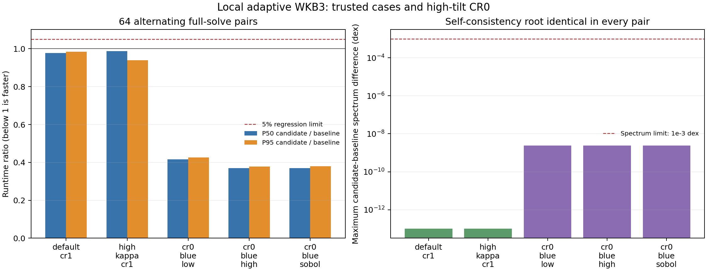

# Fast 张量传播的局部自适应 WKB3

## 结果边界

本轮没有增加 Fast 接受的参数点：对三个 CR0 高蓝倾斜代表输入，旧 Fast 与候选 Fast 均为成功。它是高相位区的计算成本优化，不计作新的求值域扩展。此前背景尺度改写得到的 CR0 高倾斜区域证据保留在 [CR0 区域核验](cr0_blue_tilt_domain_validation_summary.md)；本轮只验证 WKB3 不改变该区域的结果并显著降低传播成本。

## 方程对应与等价性

Fast 的缩放状态满足

```text
x' = -x - exp(z) y
y' =  exp(z) x + y
```

在单个光滑传播子段令 `z(N)=z0+qN`、`w=exp(z)`，消去 `y` 得
`x'' - q x' + (w²-q-1)x=0`。令 `x=exp(qN/2)u`，得到
`u'' + Ω²u=0`，其中 `Ω²=w²-α`、`α=q+1+q²/4`。WKB 基底在段首、段尾分别构成二维基本矩阵；端点基底的逆与传播基底相乘，映回 `(x,y)`。所以候选与 Fast 使用相同状态、初始值、段端状态定义和输出能量变量；只替换达到成本门槛且通过误差门的局部传递。

`S0` 的相位原函数为
`F(w)=Ω-sqrt(α) atan(Ω/sqrt(α))`，相位增量为
`(F(w1)-F(w0))/q`。二阶相位校正使用
`q/8 * [-1/Ω-5α/(3Ω³)]` 的端点差；三阶振幅校正为
`S3=-q²w²(w²+4α)/(16Ω⁶)`。程序用 WKB2 与 WKB3 的 **整个 2×2 传递矩阵 Frobenius 差**作局部嵌入误差指标，再把 WKB3 矩阵作用于实际状态。矩阵指标避免误差因某个输入状态方向的偶然抵消而变小；它是渐近阶次误差估计，不是对整条轨迹的严格全局误差证明。

只有 `Ω²` 两端严格为正、`q` 可计算、矩阵和状态均有限且缺陷不超过 `1e-5` 时才接受。转折/禁阻段、不可表示的中间矩阵、过大的阶次缺陷都逐步回退到现有相位细分。再加热 kink 仍由原网格精确拆分。默认仅当原相位算法预计至少需要 64 个子步才尝试 WKB；生产核局部基准中 64 步线性段的旧传播约 `1.726 μs`、候选矩阵估计约 `0.332 μs`，约快 5.2 倍。32 步差距约 2.9 倍，因此保留 64 步的成本门槛。

## 文献与适用假设

Agocs et al., [An efficient method for solving highly oscillatory ordinary differential equations with applications to physical systems](https://arxiv.org/abs/1906.01421), *Physical Review Research* 2, 013030 (2020)：阅读了 II.1–II.3、Appendix A 和 IV。Appendix A 的相邻 WKB 阶次差估计与本文局部 defect gate 对应；论文的振荡区自适应选择与“失败时退回既有传播”提供了方法依据。论文方法本身不直接覆盖 Fast 的张量状态和真实再加热转折；本文先通过上述消元把 Fast 的常 `q` 子段映为标量振荡方程，并将 WKB 限定在正频率段，kink/转折仍使用原传播。

## 同输入完整求解 A/B

基线为 `63aee9d180f8c570276f07177afe241dc9b8b0cd` 的生产源码副本；候选仅增加本节 WKB3 传递。候选源码哈希：`fast_sgwb.py=94936840905af9029504e369f312e0a6330ba03ef5fc2e104da5e0c9a9be9a42`、`_wkb_transfer.py=6abd58e7c6e7bb07701fe5bf4caf877220f4332b14ce274d5e7cfdbf1a26e121`。Windows affinity `[0,1]`、Numba 2/workqueue、BLAS/OMP/NUMEXPR 各 1 线程，`kink_split=True`、goal 频率网格、PCHIP；每例 2 次预热后 64 组交替完整自洽求解。原始逐次耗时、根、数组摘要和候选差值见 [benchmark JSON](benchmark_wkb3_fullsolve_screen.json)，图见下方。

| 样本 | P50 候选/基线 | P95 候选/基线 | 根相对差最大值 | 最大谱差 (dex) |
|---|---:|---:|---:|---:|
| default CR1（可信） | 0.9774 | 0.9833 | 0 | 0 |
| high-kappa CR1（可信） | 0.9869 | 0.9395 | 0 | 0 |
| CR0 蓝倾斜低振幅 `r=1e-12,n_t=.5` | 0.4170 | 0.4263 | 0 | 2.433e-9 |
| CR0 蓝倾斜高振幅 `r=1e-8,n_t=.5` | 0.3699 | 0.3788 | 0 | 2.433e-9 |
| CR0 蓝倾斜 Sobol `r=1.6763e-9,n_t=.44699` | 0.3692 | 0.3800 | 0 | 2.433e-9 |

每个 CR0 案例 64 对都得到相同自洽根；频谱和 `w2` 摘要有变化，完整谱最大差为表中数值。可信样本的 P50/P95 回退均低于 5%。全新源码路径下首次含 JIT 的完整求解时间为基线 `7.376 s`、候选 `10.173 s`；候选首次编译增加约 `38%`，须作为一次性冷启动代价披露。连续运行的预热 P50/P95 满足门槛。

历史 z10 Reference 样本在原 Fast 源哈希上给出最大根相对差 `4.8712e-6`、最大谱误差 `7.2099e-4 dex`；候选与同输入旧 Fast 的根完全相同，谱差不超过 `2.433e-9 dex`。因此按三角不等式，历史 Reference 误差加本轮候选差仍低于 `2e-4` 和 `1e-3 dex` 验收线。Reference 源码未改，本轮没有重复启动昂贵 Reference。



## 验证与剩余限制

- `tests/test_wkb3_fast_transfer.py`：真实 CR0 高相位段对精确 Bessel 线性段映射、矩阵级 defect 状态无关、过紧容差逐位回退、转折区逐位回退。
- 完整 pytest：`436 passed, 9 deselected, 2 warnings`。
- Ruff、项目 CI 使用的 `python -m mypy`、compileall、sdist/wheel build 通过。直接 `mypy stiffgwpy_fast` 会扫描非项目配置范围并报告 286 条既有类型错误，不是项目 CI 命令。
- 本轮局部阈值来自传播子步成本和阶次误差估计，不依赖参数点。WKB3 仍只是一种局部渐近近似；结果不构成连续参数域证明。完整冷启动有一次额外 JIT 编译成本。
