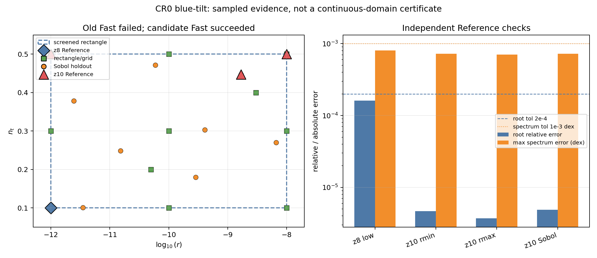

# CR0 正倾斜扩域：z10 精度核验

候选提交：`8a4b925cdd7456c32027cf3b436ea4db0abc1526`；`fast_sgwb.py` SHA256：`98a0fe0961b93689a74f63ad9c77ea29c60dd23b68a6ab346d6f984c72bb03e5`。
固定背景为 `cr=0`、`Omega_bh2=1e6`、`Omega_ch2=0.1201075`、`T_re=2000`、`kappa10=0.01`；抽样矩形为 `r∈[1e-12,1e-8]`、`n_t∈[0.1,0.5]`。筛查点均为有限正 H²。

快速筛查：旧 Fast 成功 `0/19`，新 Fast 成功 `19/19`；旧失败全为 `nonfinite_background_primitive`。该比例是有限采样证据，不是连续域证明。

精度核验（Reference 代码与阈值未改）：

| 样本 | r | n_t | Reference | root relative error | 最大频谱误差 (dex) | Fast 单次时间 (s) |
|---|---:|---:|---|---:|---:|---:|
| 低角点 | 1e-12 | 0.1 | z8 | 0.000161 | 0.000802 | 0.286 |
| 高倾斜低振幅 | 1e-12 | 0.5 | z10 | 4.66e-06 | 0.000721 | 0.446 |
| 高倾斜高振幅 | 1e-08 | 0.5 | z10 | 3.7e-06 | 0.000702 | 0.353 |
| Sobol 留出 | 1.68e-09 | 0.447 | z10 | 4.87e-06 | 0.00072 | 0.34 |

z10 三点最大根误差为 `4.87e-06`，最大谱误差为 `0.000721 dex`，均低于验收限。原 z8 高倾斜个别根误差略超限的问题，与尾部截断有关；z10 闭合后当前源码样本通过。一个 `n_t=0.2` 文件因 Fast 源码哈希不一致而排除。

性能仍未验收：同硬件可信区 A/B 汇总 P50/P95 比为 `1.022/1.044`，但逐例最大比为 `1.0666/1.1072`，超过 5% 上限；本次未更改生产代码。

原始输入、完整谱与 Reference 数组保存在相邻 z10 JSON 文件中；本图只标示采样设计与精度样本。
