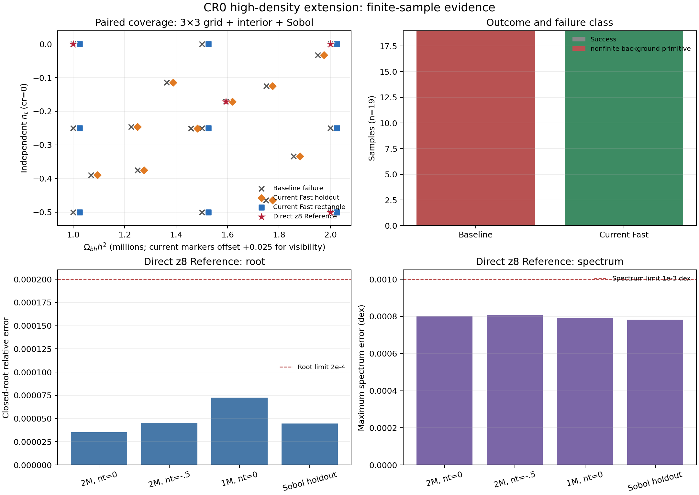

# CR0 高密度区域的 Fast 求值域扩展

## 区域与参数约束

本轮检验 `cr=0` 的二维切片，`n_t` 是独立输入；不套用 `cr>0` 的一致性倾斜关系。固定 `Omega_ch2=0.1201075`、`H0=67.32117`、`DN_eff=0`、`A_s=2.100549e-9`、`r=.01`、`T_re=2000`、`DN_re=10`、`kappa10=.01`，扫描
`Omega_bh2∈[1e6,2e6]`、`n_t∈[-.5,0]`。所有 Fast 样本使用默认 Fast 配置、goal 频率网格、2 threads、`tol=1e-6` 和 `physical_guard=True`。

H² 预检覆盖 19 个点，均为有限正值，最小值约 `0.4532139932`；所有 `N_inf` 均有限，所有候选均通过物理 guard。原方程的物理转折条件不变。

## 同输入旧/新 Fast

旧版基线固定为 `872a70dc5ab3bb2ff9d3c0d78f05850341b42a45`；候选 Fast 源于 `702d54347e3c489d1632142dc3151cbd54dd6657`。在 `{1e6,1.5e6,2e6} × {-.5,-.25,0}` 的 3×3 网格和两个内部 holdout 上，旧 Fast `0/11`、当前 Fast `11/11`。8 个独立 scrambled Sobol 点（seed `20261123`）旧 Fast `0/8`、当前 Fast `8/8`。19 个旧失败全部是 `nonfinite_background_primitive`；当前无失败。对应原始记录： [3×3+holdout screen](screen_cr0_high_density_extension.json)、[独立 Sobol screen](screen_cr0_high_density_extension_sobol.json)。

## Reference 精度核验

未修改 Reference 方程、生产代码或验收值。4 个直接 z8 Reference 样本覆盖新增上边界两角、下边界另一角及一个独立 Sobol 内部留出：

| 样本 | `Omega_bh2` | `n_t` | 闭合根相对误差 | 最大谱差 (dex) |
|---|---:|---:|---:|---:|
| 上边界零倾斜角 | 2.0e6 | 0 | 3.525e-5 | 7.993e-4 |
| 上边界负倾斜角 | 2.0e6 | -0.5 | 4.553e-5 | 8.085e-4 |
| 下边界零倾斜角 | 1.0e6 | 0 | 7.261e-5 | 7.935e-4 |
| Sobol 留出 | 1.593e6 | -0.17135 | 4.479e-5 | 7.817e-4 |

最大 Reference 闭合残差 `7.732e-8`；全部低于 `2e-4` 根误差和 `1e-3 dex` 频谱误差验收线。完整 Reference arrays 与映射历史见 [z8 validation JSON](validate_cr0_high_density_extension_z8.json)。

## 计算效率 A/B

另以 `63aee9d180f8c570276f07177afe241dc9b8b0cd`（稳定背景、未启用 WKB3）为基线，对当前 WKB3 Fast 做同硬件、同线程、64 组交替完整求解。Windows affinity `[0,1]`、Numba 2/workqueue、BLAS 1、goal/PCHIP。旧、新在所有比较点均成功，频率网格完全一致，闭合根差不超过 `1.24e-15`；最大谱差 `5.45e-9 dex`。

| 区域样本 | 候选 P50/P95 (ms) | 候选/基线 P50/P95 |
|---|---:|---:|
| 已有区内对照 1.0e6, -0.5 | 27.36 / 28.61 | 0.254 / 0.261 |
| 新区 1.5e6, -0.5 | 27.23 / 28.35 | 0.299 / 0.305 |
| 新区 2.0e6, -0.5 | 26.76 / 27.88 | 0.328 / 0.335 |
| 新区 2.0e6, 0 | 26.68 / 27.75 | 0.329 / 0.336 |
| Sobol 留出 | 27.15 / 28.25 | 0.307 / 0.314 |
| 已有区 holdout 7.5e5, -0.125 | 25.62 / 26.40 | 0.388 / 0.392 |

原始逐对耗时、完整结果 hash、首次含 JIT 时间和输入见 [64-pair A/B JSON](benchmark_cr0_wkb3_negative_tilt_ab.json)。独立高密度 slice 的 warm Fast P50/P95 约 `26.7–27.4 / 27.8–28.6 ms`，与同批旧区 holdout 约 `25.6 / 26.4 ms` 同一计算级别。全新源码路径首次含 JIT 的基线/候选求解约 `9.60/19.29 s`；额外的一次性编译时间仍需披露。

## 覆盖图与限制

图中偏移 `0.025` 百万单位的当前点仅为避免标记重叠；所有配对输入原值保存在 JSON。有限 lattice、内部点和 Sobol 样本支持该矩形扩展，但不构成数学上的连续域证明。Reference 精度核验仅覆盖表中四个代表点，不能外推为矩形内每个点的严格误差界。

候选源码 SHA256：`exact_background.py=c55ff5755615a0eaa5a2f4c7ddbd938f84ffa1fe1cf722866c7b04225752e313`、`fast_sgwb.py=94936840905af9029504e369f312e0a6330ba03ef5fc2e104da5e0c9a9be9a42`、`_wkb_transfer.py=6abd58e7c6e7bb07701fe5bf4caf877220f4332b14ce274d5e7cfdbf1a26e121`；Reference SHA256 为 `4e2eb80709da944923206a840c0864d454faad9b51dc3fb9ebfda90abe460536`。
